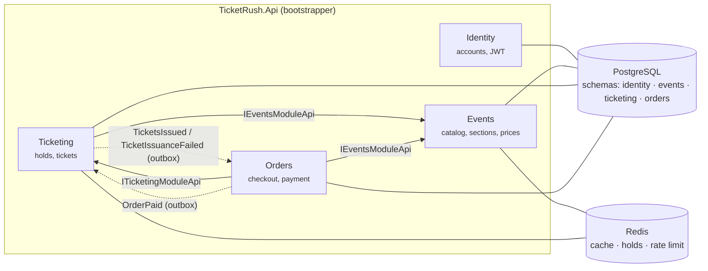
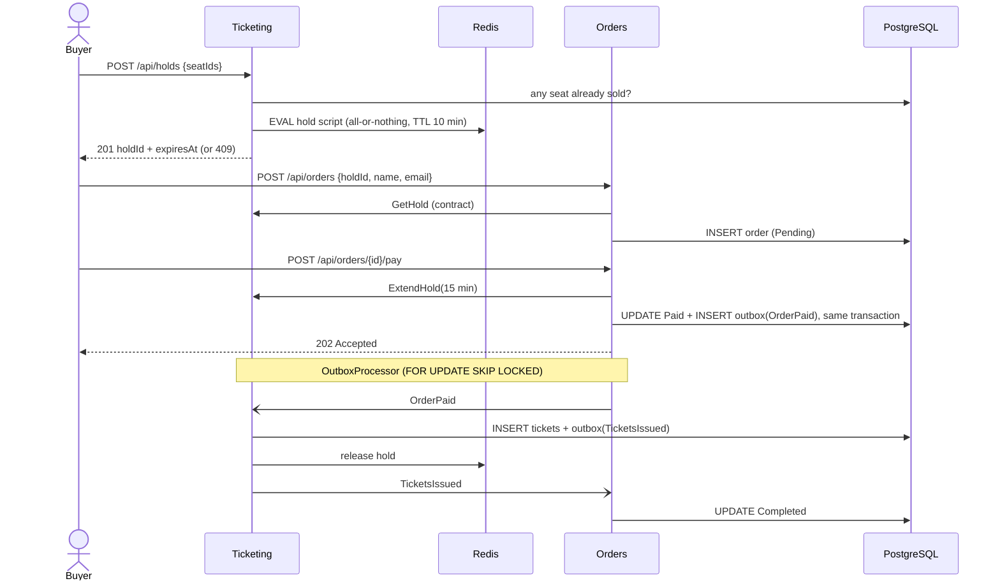

# TicketRush

A ticketing system built around one hard problem: when sales open and thousands of people click the same seat at the same time, nobody should end up with a ticket for a seat that someone else already bought.

Seats are held for ten minutes while the buyer checks out. The hold is an atomic Redis operation, the sale is protected by a database constraint, and the rare conflict that slips through is refunded automatically.


**Stack:** .NET 10 Minimal API · modular monolith · PostgreSQL + Dapper · DbUp · Redis · React + Vite + TypeScript · Testcontainers · k6

## How overselling is prevented

A plain `SELECT` followed by an `UPDATE` races under load. TicketRush protects each seat at three levels:

1. **Hold (Redis).** A Lua script checks and sets every requested seat key in a single atomic step: either all seats are held or none are. Holds expire on their own after 10 minutes.
2. **Sale (PostgreSQL).** `ticketing.tickets` has a `UNIQUE (event_id, seat_id)` constraint, so the database will never store two tickets for the same seat, even if a hold expires mid-payment.
3. **Compensation.** If ticket issuance hits that constraint, Ticketing publishes `TicketIssuanceFailed` and Orders refunds the order.

### Load test

With k6, 500 virtual users hit the 10-seat "Pré-estreia Secreta" event at once (2 of its seats were already sold):

```
holds_accepted .....: 8      ✓ count<=10
holds_rejected .....: 492
checks_succeeded ...: 100%   every response was 201 or 409, no errors
```

Exactly one winner per free seat.

## Architecture

The system is one deployable split into modules. Each module owns its endpoints, its PostgreSQL schema and its migrations. Modules talk to each other only through `*.Contracts` projects (interfaces plus integration events), and architecture tests enforce that rule.



```
src/
  Bootstrapper/TicketRush.Api        Program.cs, which only composes the modules
  Shared/TicketRush.Shared           IModule, DbUp runner, outbox, event bus, cache, rate limit, JWT
  Modules/
    Identity/  TicketRush.Modules.Identity
    Events/    TicketRush.Modules.Events      (+ .Contracts)
    Ticketing/ TicketRush.Modules.Ticketing   (+ .Contracts)
    Orders/    TicketRush.Modules.Orders      (+ .Contracts)
      └─ Database/Scripts/*.sql      DbUp migrations embedded in the module assembly
tests/
  TicketRush.ArchitectureTests       module boundary rules (NetArchTest)
  TicketRush.IntegrationTests        real PostgreSQL + Redis via Testcontainers
frontend/                            React + Vite + TypeScript
loadtest/oversell.js                 k6 script
```

### Purchase flow



## Where each piece fits

**Redis**
- Seat holds in [`SeatHoldStore.cs`](src/Modules/Ticketing/TicketRush.Modules.Ticketing/Holds/SeatHoldStore.cs): Lua scripts for acquire, extend and release. Release only deletes keys that still belong to the hold.
- Live seat map: one `MGET` returns the state of every seat in an event.
- Cache-aside for the event catalog in [`EventsRepository.cs`](src/Modules/Events/TicketRush.Modules.Events/Features/EventsRepository.cs), invalidated when an event is created.
- A fixed-window rate limit (`INCR` + `EXPIRE`) on the hold endpoint, shared by every API instance.

**DbUp**
- Each module embeds its SQL scripts in `Database/Scripts/` and keeps its own journal (`{schema}.schema_versions`), so modules evolve their schemas independently, the way separate services would. See [`DatabaseMigrator.cs`](src/Shared/TicketRush.Shared/Database/DatabaseMigrator.cs).
- Versioned plain SQL pairs well with Dapper: no ORM and no hidden queries.

**Authentication**
- The `Identity` module owns accounts in its own `identity` schema. Passwords are hashed with ASP.NET Core Identity's `PasswordHasher` (PBKDF2, HMAC-SHA512, 100k iterations).
- Register and login return a JWT (HS256, 8 h). Holds and orders require it, and each hold or order belongs to the user in the token's `sub` claim, so "My tickets" works on any device.
- Login and register are rate limited per IP. A wrong email and a wrong password return the same message, so the API does not reveal who has an account.
- Admins are not a sign-up option: they come from configuration (`Auth:AdminEmails`, or `ADMIN_EMAIL` in `.env`). Only admins can create events, either through the API or the admin page at `/admin/eventos/novo`, which shows a live preview of the curved seat map while you set up the sections.

**Modular monolith**
- `Program.cs` only knows `IModule`. Registering a module takes one line.
- Synchronous calls go through contract interfaces. Asynchronous ones go through integration events and a transactional outbox (one per schema). Swapping the in-memory bus for RabbitMQ would not change the modules.
- Architecture tests check that no module references another module's implementation and that the `XxxModule` class is the only public type in each module.

## Running it

### With Docker

```bash
cp .env.example .env      # set AUTH_SIGNING_KEY (32+ random chars) and, optionally, ADMIN_EMAIL
docker compose up -d --build
```

Without `AUTH_SIGNING_KEY` the API still starts, but it generates a temporary key, so everyone is signed out whenever it restarts.

- Web: http://localhost:8088
- API reference (Scalar): http://localhost:5080/scalar

The app also works from other devices on the same network at `http://<your-machine-ip>:8088`.

### Local development

```bash
docker compose up -d postgres redis
dotnet run --project src/Bootstrapper/TicketRush.Api   # http://localhost:5080
cd frontend && npm install && npm run dev               # http://localhost:5173
```

Migrations run when the API starts and seed a handful of demo events.

### Tests

```bash
dotnet test        # Docker must be running (Testcontainers)
```

| Test | What it shows |
| --- | --- |
| `Concurrent_holds_on_the_same_seat_should_have_exactly_one_winner` | 200 simultaneous requests for one seat: exactly one `201`, 199 `409` |
| `Hold_is_all_or_nothing` | If one requested seat is taken, none of them are held |
| `Full_purchase_issues_tickets_through_the_outbox` | Hold, order, payment, then tickets issued asynchronously |
| `Another_client_cannot_checkout_someone_elses_hold` | A hold belongs to whoever created it |
| `AuthTests` | Register, login, duplicate email, weak password, login required for holds, admin-only event creation, "my orders" isolation |
| `ModuleBoundaryTests` | Module boundaries and per-module migrations |

### Load test

The script signs up 100 buyers first, so start the API with a higher sign-up limit:

```bash
AUTH_RATE_LIMIT=1000 docker compose up -d api
docker run --rm -v "$PWD/loadtest:/scripts" -e BASE_URL=http://host.docker.internal:5080 grafana/k6 run /scripts/oversell.js
```

## API

| Method | Route | Module | Auth |
| --- | --- | --- | --- |
| `POST` | `/api/auth/register` | Identity | public, rate limited |
| `POST` | `/api/auth/login` | Identity | public, rate limited |
| `GET` | `/api/auth/me` | Identity | user |
| `GET` | `/api/events` | Events (cached) | public |
| `GET` | `/api/events/{id}` | Events (cached) | public |
| `POST` | `/api/events` | Events | admin |
| `GET` | `/api/events/{id}/seats` | Ticketing | public |
| `POST` | `/api/holds` | Ticketing (rate limited) | user |
| `GET` / `DELETE` | `/api/holds/{id}` | Ticketing | user (owner) |
| `GET` | `/api/orders` | Orders | user (own orders) |
| `POST` | `/api/orders` | Orders | user |
| `POST` | `/api/orders/{id}/pay` | Orders | user (owner) |
| `GET` | `/api/orders/{id}` | Orders | user (owner) |

Send the token as `Authorization: Bearer <token>`.

## Decisions and trade-offs

- **Seats are not rows.** They are derived from each section's rows and seats per row and named like `VIP-A12`, which avoids thousands of rows per event. Sold seats live in `ticketing.tickets`; held seats live in Redis.
- **Bounded connection pool** (`Database:MaxPoolSize`, default 40). The concurrency test showed that Npgsql's default of 100 matches PostgreSQL's default `max_connections`, so a burst of traffic got "too many clients" errors. With a smaller pool, requests wait their turn instead of failing.
- **Simulated payment.** No card data is collected. The payment and refund calls are where a real gateway would plug in.
- **In-memory bus + outbox.** Delivery is at-least-once, so the handlers are idempotent.

## What's next

- [ ] Refresh tokens and password reset by e-mail
- [ ] Push seat-map updates over SignalR (Redis backplane) instead of polling
- [ ] Virtual waiting room for very high-demand events
- [ ] OpenTelemetry traces across hold → order → issuance

<p align="center">
  
  
</p>
