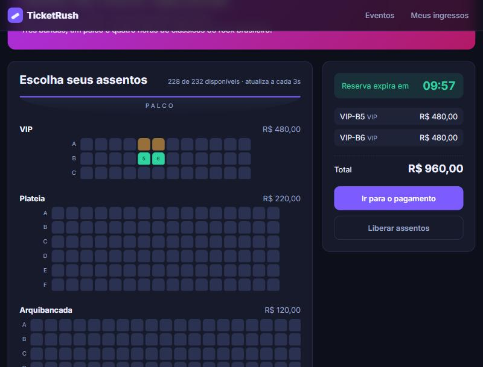
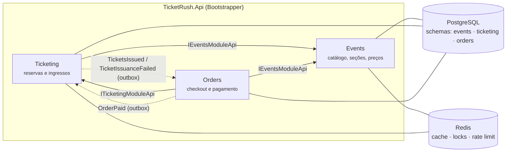
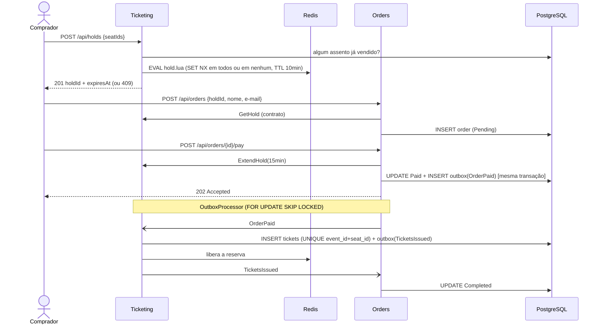
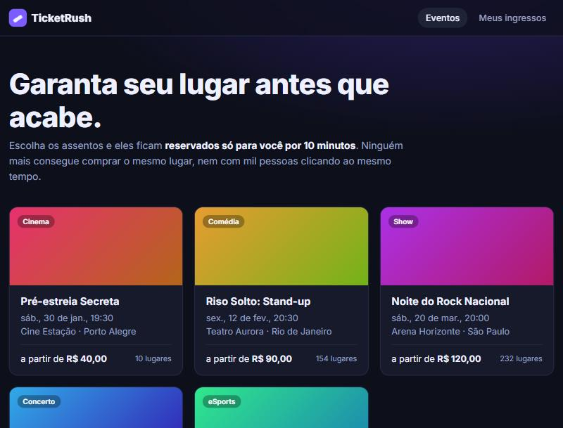
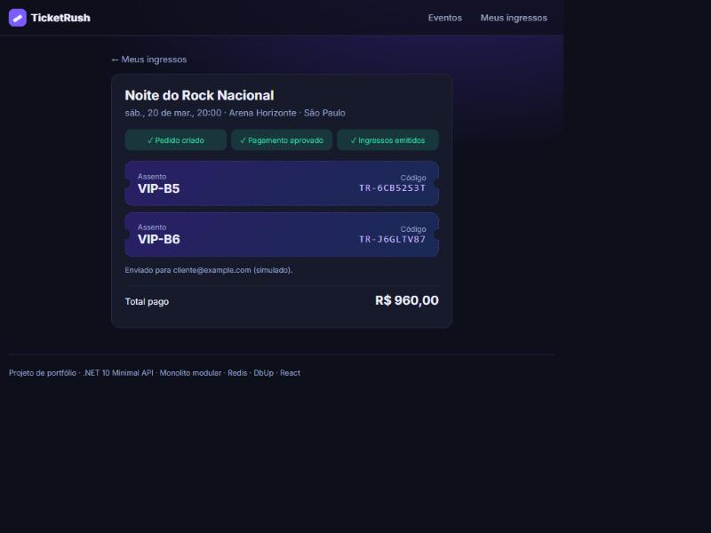

# 🎟 TicketRush

Venda de ingressos com **reserva temporária de assentos**, feita para aguentar o "pico de abertura de vendas" sem vender o mesmo lugar duas vezes.

**.NET 10 Minimal API** · **Monolito modular** · **Redis** · **DbUp** · **PostgreSQL** · **Dapper** · **React + Vite + TypeScript** · **Testcontainers** · **k6**



## O problema

Quando as vendas de um show abrem, milhares de pessoas clicam no mesmo assento ao mesmo tempo. Um `SELECT` seguido de `UPDATE` cria uma condição de corrida, e o resultado é **overselling**: dois ingressos para a mesma cadeira.

O TicketRush resolve isso em camadas:

| Camada | Onde | O que garante |
| --- | --- | --- |
| **Lock distribuído com Lua** | Redis | Reserva *all-or-nothing* de vários assentos, atômica, com TTL de 10 min |
| **Constraint única** | PostgreSQL `UNIQUE (event_id, seat_id)` | Última linha de defesa: o banco nunca aceita dois ingressos para o mesmo lugar |
| **Compensação** | Evento `TicketIssuanceFailed` | Se mesmo assim houver conflito, o pedido é estornado automaticamente |

### Resultado do teste de carga (k6)

500 compradores simultâneos disputando os 10 lugares do evento "Pré-estreia Secreta" (2 já vendidos):

```
holds_accepted ......: 8     ✓ count<=10
holds_rejected ......: 492
checks_succeeded ....: 100.00%  (todas as respostas foram 201 ou 409, nenhum erro)
```

**Zero overselling.** Exatamente um vencedor por assento.

## Arquitetura

Monolito modular: **um deploy, módulos isolados**. Cada módulo é dono dos seus endpoints, do seu schema no PostgreSQL e das suas migrações. Um módulo só fala com outro pelo projeto `*.Contracts` (interfaces e eventos de integração), e isso é **verificado por testes de arquitetura**.



```
src/
  Bootstrapper/TicketRush.Api        → Program.cs: só compõe os módulos
  Shared/TicketRush.Shared           → IModule, DbUp, Outbox, EventBus, cache, rate limit
  Modules/
    Events/    TicketRush.Modules.Events      (+ .Contracts)
    Ticketing/ TicketRush.Modules.Ticketing   (+ .Contracts)
    Orders/    TicketRush.Modules.Orders      (+ .Contracts)
      └─ Database/Scripts/*.sql      → migrações DbUp embutidas no assembly do módulo
tests/
  TicketRush.ArchitectureTests       → regras de fronteira entre módulos (NetArchTest)
  TicketRush.IntegrationTests        → PostgreSQL + Redis reais via Testcontainers
frontend/                            → React + Vite + TypeScript
loadtest/oversell.js                 → script k6
```

### Fluxo de compra



## Onde cada tecnologia entra

### Redis
- **Reserva de assentos** ([`SeatHoldStore.cs`](src/Modules/Ticketing/TicketRush.Modules.Ticketing/Holds/SeatHoldStore.cs)): um script Lua verifica e grava todas as chaves `hold:seat:{evento}:{assento}` numa única operação atômica. Expira sozinho com TTL.
- **Mapa de assentos em tempo real**: um único `MGET` traz o estado de centenas de assentos.
- **Cache-aside** do catálogo de eventos ([`EventsRepository.cs`](src/Modules/Events/TicketRush.Modules.Events/Features/EventsRepository.cs)), invalidado quando um evento é criado.
- **Rate limit distribuído** na rota de reserva (`INCR` + `EXPIRE`), que vale para todas as instâncias da API.

### DbUp
- Cada módulo embute seus scripts em `Database/Scripts/*.sql` e tem **seu próprio journal** (`{schema}.schema_versions`). Os módulos evoluem o banco de forma independente, como se fossem serviços separados ([`DatabaseMigrator.cs`](src/Shared/TicketRush.Shared/Database/DatabaseMigrator.cs)).
- SQL puro e versionado combina com o Dapper: sem ORM e sem "mágica" no acesso a dados.

### Monolito modular
- O `Program.cs` só conhece `IModule`. Adicionar um módulo é uma linha.
- Comunicação síncrona por **interfaces de contrato** e assíncrona por **eventos de integração + Transactional Outbox** (um outbox por schema). Trocar o barramento em memória por RabbitMQ não exige mudar os módulos.
- **Testes de arquitetura** garantem que nenhum módulo referencia a implementação de outro e que só a classe `XxxModule` é pública.

## Como rodar

### Tudo com Docker

```bash
docker compose up -d --build
```

- Front: http://localhost:8088
- API + documentação (Scalar): http://localhost:5080/scalar

### Desenvolvimento

```bash
docker compose up -d postgres redis
dotnet run --project src/Bootstrapper/TicketRush.Api   # http://localhost:5080
cd frontend && npm install && npm run dev               # http://localhost:5173
```

As migrações (DbUp) rodam na inicialização da API e já criam eventos de demonstração.

### Testes

```bash
dotnet test        # precisa do Docker rodando (Testcontainers)
```

| Teste | O que prova |
| --- | --- |
| `Concurrent_holds_on_the_same_seat_should_have_exactly_one_winner` | 200 requisições simultâneas no mesmo assento → exatamente 1 `201` e 199 `409` |
| `Hold_is_all_or_nothing` | Se 1 dos assentos está ocupado, nenhum é reservado |
| `Full_purchase_issues_tickets_through_the_outbox` | Reserva → pedido → pagamento → ingressos emitidos de forma assíncrona |
| `Another_client_cannot_checkout_someone_elses_hold` | A reserva pertence a quem a criou |
| `ModuleBoundaryTests` | Fronteiras entre módulos e migrações por módulo |

### Teste de carga

```bash
docker run --rm -v "$PWD/loadtest:/scripts" -e BASE_URL=http://host.docker.internal:5080 grafana/k6 run /scripts/oversell.js
```

## Endpoints

| Método | Rota | Módulo |
| --- | --- | --- |
| `GET` | `/api/events` | Events (cache Redis) |
| `GET` | `/api/events/{id}` | Events (cache Redis) |
| `POST` | `/api/events` | Events |
| `GET` | `/api/events/{id}/seats` | Ticketing |
| `POST` | `/api/holds` | Ticketing (rate limit) |
| `GET` / `DELETE` | `/api/holds/{id}` | Ticketing |
| `POST` | `/api/orders` | Orders |
| `POST` | `/api/orders/{id}/pay` | Orders |
| `GET` | `/api/orders/{id}` | Orders |

O comprador é identificado pelo header `X-Client-Id` (UUID gerado pelo front). Num sistema real ele viria do usuário autenticado.

## Decisões e trade-offs

- **Assentos não são uma tabela**: são derivados de `(seção, fileiras, assentos por fileira)`, no formato `VIP-A12`. Isso evita milhares de linhas por evento. Vendidos ficam em `ticketing.tickets`, reservados ficam no Redis.
- **Pool de conexões limitado** (`Database:MaxPoolSize`, padrão 40). O teste de concorrência revelou que, com o padrão do Npgsql (100), um pico de acessos esgotava o `max_connections` do PostgreSQL. Com o limite, as requisições aguardam a vez em vez de falhar.
- **Pagamento simulado**: nenhum dado de cartão é coletado. O ponto de integração com um gateway está marcado no código (pagamento e estorno).
- **Barramento em memória + outbox**: entrega *at-least-once*, com handlers idempotentes.

## Próximos passos

- [ ] Autenticação (JWT) no lugar do `X-Client-Id`
- [ ] Atualização do mapa via SignalR (Redis backplane) em vez de polling
- [ ] Fila virtual para eventos muito disputados
- [ ] OpenTelemetry (traces do fluxo reserva → emissão)

---

<p align="center">
  
  
</p>
